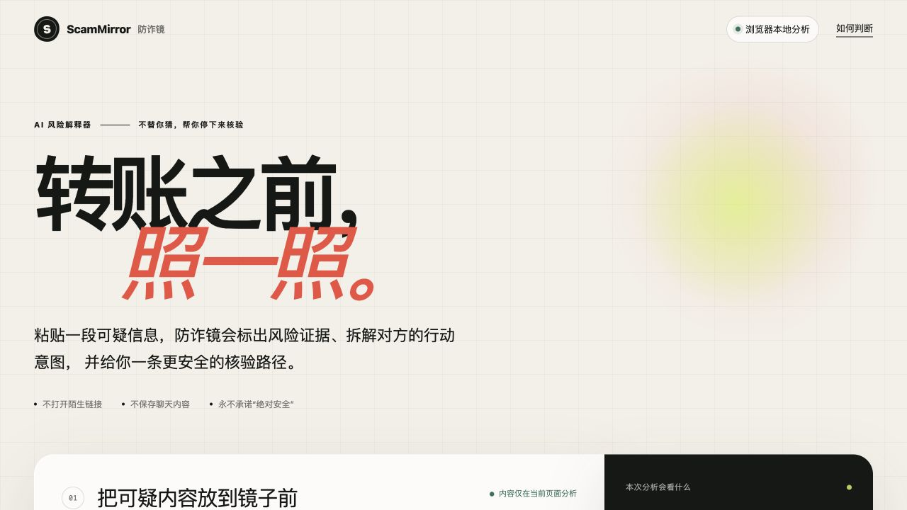
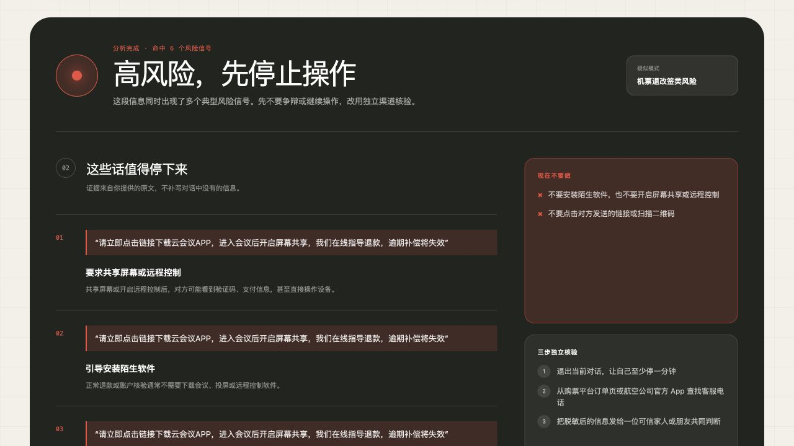
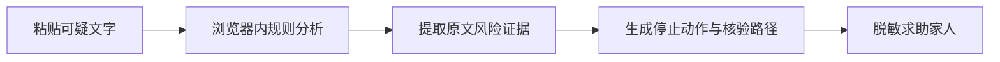

# ScamMirror 防诈镜

> 转账之前，照一照。

[](CHANGELOG.md)
[](LICENSE)
[](#本地运行)
[](PRIVACY.md)

ScamMirror 是一个隐私优先、可解释的反诈风险助手。粘贴一段可疑信息后，它会标出原文证据、解释对方试图推动的行动，并给出一条绕开可疑链接、号码和二维码的独立核验路径。

**[在线体验](https://scammirror-20260726.chilinzhang112.chatgpt.site)** · [产品需求](docs/PRD.md) · [评测方法](docs/EVALUATION.md) · [技术架构](docs/ARCHITECTURE.md) · [路线图](ROADMAP.md)

> 在线体验当前部署在私有预览环境，可能需要登录 ChatGPT。仓库本地运行不需要登录、数据库或 API Key。



## 它解决什么问题

面对催促转账、下载软件、共享屏幕或提供验证码的信息，用户真正需要的不只是一个“诈骗概率”，而是：

1. **先停下来**：在不可逆操作前打断紧迫感；
2. **看懂证据**：指出原文中究竟哪句话值得警惕；
3. **绕开可疑渠道**：通过自己找到的官方入口独立核验；
4. **安全求助**：生成不包含原始聊天内容的家人求助卡。



## v0.1.0 可以做什么

- 粘贴中文可疑信息并在浏览器内分析
- 机票退款、刷单返利、冒充熟人、普通通知四个演示案例
- 输出“高风险 / 需要核验 / 暂未发现明显风险”三级结果
- 标出连续的原文证据，并解释对应风险机制
- 给出“现在不要做”和“三步独立核验”
- 生成不包含原始聊天内容的家人求助文字
- 支持移动端、键盘操作和减少动态效果偏好
- 无需账号、数据库或模型 API Key

## 产品演示

选择“机票退款”，点击“开始照一照”，系统会识别陌生软件、屏幕共享、紧迫感等风险信号，并把证据和安全行动放在同一结果页。



## 为什么不用一个“诈骗概率”

ScamMirror 不把规则分数包装成真实概率，也永远不显示“确定安全”。防诈工具最危险的失败不是多提醒一次，而是错误地让用户放心。因此 v0.1.0 优先优化：

- 高风险案例不要被降为低风险
- 每条证据必须来自用户输入
- 行动建议不能把用户带回对方提供的渠道
- 没有命中规则时仍然提醒独立核验

## 本地运行

需要 Node.js 22.13 或更高版本，以及 pnpm。

```bash
git clone https://github.com/wangwangnan1124/ScamMirror.git
cd ScamMirror
pnpm install
pnpm dev
```

打开终端显示的本地地址即可使用。v0.1.0 没有环境变量，也不会调用第三方模型。

完整检查：

```bash
pnpm check
```

或分别运行：

```bash
pnpm lint
pnpm test
pnpm eval
```

## 评测

仓库提供 24 条原创合成案例，用于验证规则和评测管线：

| 指标 | v0.1.0 工程基线 |
|---|---:|
| 风险等级匹配率 | 100% |
| 高风险非低风险召回率 | 100% |
| 高风险错误放心 | 0 条 |
| 金标信号召回率 | 87.2% |

这些数字只描述当前合成数据集，**不能外推为真实世界诈骗识别准确率**。数据结构、发布门槛和限制详见 [评测文档](docs/EVALUATION.md)。

## 项目结构

```text
app/
  page.tsx                 # 主要产品交互
  globals.css              # 响应式视觉系统
  lib/scam-rules.ts        # 可解释规则引擎
docs/
  PRD.md                   # 产品需求文档
  ARCHITECTURE.md          # 当前与目标架构
  EVALUATION.md            # 评测方法与发布门槛
evals/
  scam-cases.jsonl         # 合成评测数据
scripts/
  evaluate-rules.mjs       # 自动评测脚本
tests/                     # 规则与渲染测试
```

## 隐私与安全边界

- 输入内容只在当前浏览器页面分析
- 不自动打开输入中的链接或二维码
- 不自动联系疑似诈骗者
- 不认定某个具体个人或机构实施了诈骗
- 不以分析结果替代警方、银行或机构判断
- 不承诺追回资金
- 真实聊天记录不得未经授权提交到仓库

详见 [隐私说明](PRIVACY.md) 和 [安全策略](SECURITY.md)。

## Roadmap

- **v0.2**：浏览器本地 OCR、敏感信息遮盖、截图证据高亮
- **v0.3**：可选的服务端多模态分析、结构化输出、规则否决机制
- **v0.4**：反馈闭环、脱敏失败案例、自动回归看板

完整计划见 [ROADMAP.md](ROADMAP.md)。

## 参与贡献

欢迎提交原创合成案例、误报/漏报修复、无障碍优化和安全测试。请不要提交未经同意的聊天截图、真实账户信息、验证码或可访问的钓鱼链接。

提交前请阅读 [CONTRIBUTING.md](CONTRIBUTING.md)。

准备发布自己的 Fork 时，可以按 [v0.1.0 发布清单](docs/RELEASE_CHECKLIST.md)逐项检查。

## 官方参考

- [工业和信息化部：反诈“国家队”推出七大反诈利器](https://tjca.miit.gov.cn/zwgk/wlaqgl/art/2023/art_117628b2c6154990a31d9f886e9a1028.html)
- [FTC: What are the signs of a scam?](https://consumer.ftc.gov/consumer-alerts/2025/03/what-are-signs-scam)

## 免责声明

ScamMirror 用于风险提示与反诈教育，不能确认某个人或机构实施了诈骗，也不能替代警方、银行、支付平台或相关机构的正式判断。正在转账或已经泄露凭证时，应立即停止操作并联系支付机构；紧急情况请联系当地警方。

## License

[MIT](LICENSE)
