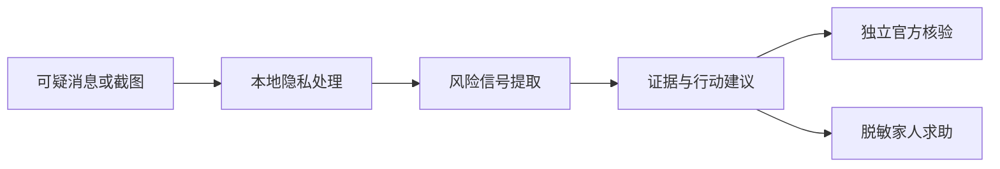

# ScamMirror 防诈镜

> 转账之前，照一照。

ScamMirror 是一个可解释的反诈风险助手。用户粘贴可疑信息后，它不会只给出一个“诈骗概率”，而会标出原文证据、解释对方在诱导什么，并生成一条绕开可疑链接与号码的独立核验路径。

当前版本是一个不依赖模型密钥的交互式 MVP：风险分析在浏览器内完成，适合产品验证、黑客松演示和后续接入视觉/语言模型。

## 为什么做这个项目

反诈工具最危险的失败并不是“多提醒了一次”，而是错误地让用户放心。因此 ScamMirror 的产品目标不是追求一个看起来精确的诈骗概率，而是：

1. 在付款、下载软件、共享屏幕或泄露敏感信息前制造一次有效停顿；
2. 用可追溯的原文证据解释风险；
3. 把用户带到独立、可信的核验渠道；
4. 帮助用户以脱敏方式向家人求助。

## 可运行功能

- 粘贴中文可疑信息并在本地分析
- 机票退款、刷单返利、冒充熟人、普通通知四个演示案例
- 高风险 / 需要核验 / 暂未发现明显风险三级结果
- 原文风险证据与话术解释
- “现在不要做”与“三步独立核验”
- 脱敏家人求助卡与一键复制
- 截图本地预览，以及视觉模型/OCR 的清晰接入位置
- 移动端优先、键盘可用、减少动态效果适配

## 产品演示路径

1. 选择“机票退款”案例；
2. 点击“开始照一照”；
3. 查看系统标出的紧迫性、陌生软件、屏幕共享等证据；
4. 查看不使用对方链接的核验路径；
5. 生成脱敏求助卡。



## 本地运行

需要 Node.js 22.13 或更高版本。

```bash
pnpm install
pnpm dev
```

生产构建：

```bash
pnpm build
```

运行本地规则基线评测：

```bash
pnpm eval
```

## 项目结构

```text
app/
  page.tsx                 # 完整交互界面
  globals.css              # 响应式视觉系统
  lib/scam-rules.ts        # 可解释规则引擎
docs/
  PRD.md                   # 产品需求文档
  EVALUATION.md            # 评测目标、方法与发布门槛
  ARCHITECTURE.md          # 当前及目标架构
evals/
  scam-cases.jsonl         # 合成评测样例
ROADMAP.md                 # 迭代路线图
```

## 当前判断方式

当前 MVP 使用透明的风险规则，覆盖：

- 验证码和敏感信息
- 共享屏幕或远程控制
- 陌生软件和安装包
- 安全账户、垫资、保证金
- 不可逆付款方式
- 紧迫感与保密要求
- 冒充权威或熟人
- 陌生链接与二维码
- 异常高回报
- 账户冻结与法律威胁

规则输出固定结构，不把分数包装成真实概率。目标版本会在规则层之外加入视觉模型、结构化语言模型和经审核的官方知识卡。

## 安全边界

- 永远不显示“确定安全”
- 不自动打开输入中的链接或二维码
- 不自动联系疑似诈骗者
- 不以 AI 结果替代警方、银行或机构判断
- 默认不持久化原始聊天内容
- 已转账或泄露凭证时，优先建议立即联系支付机构和警方
- 不承诺追回资金

## 评测

仓库中的初始数据集是用于搭建流程的合成样例，不代表上线质量。发布门槛重点关注：

- 高风险案例召回率
- 错误放心率
- 证据片段准确率
- 安全行动理解率
- 独立核验完成率

v0.1 在 24 条合成案例上的工程基线为：风险等级匹配率 100%、高风险非低风险召回率 100%、错误放心 0 条、金标信号召回率 87.2%。这些数字只用于验证当前规则和评测管线，不能外推为真实诈骗识别准确率。

详见 [docs/EVALUATION.md](docs/EVALUATION.md)。

## 官方参考

- [反诈“国家队”推出七大反诈利器](https://tjca.miit.gov.cn/zwgk/wlaqgl/art/2023/art_117628b2c6154990a31d9f886e9a1028.html)
- [FTC: What are the signs of a scam?](https://consumer.ftc.gov/consumer-alerts/2025/03/what-are-signs-scam)

## 免责声明

ScamMirror 用于风险提示与反诈教育，不能确认某个人或机构实施了诈骗，也不能替代警方、银行、支付平台或相关机构的正式判断。紧急情况请联系当地警方。

## License

[MIT](LICENSE)
