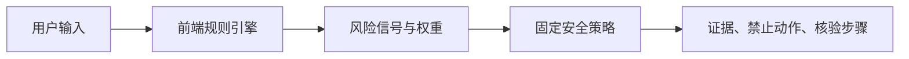
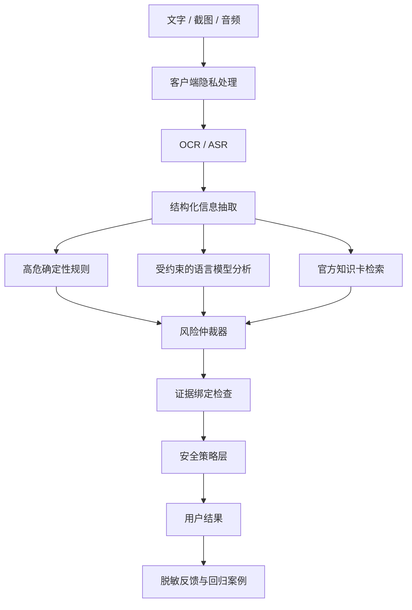

# ScamMirror 技术与产品架构

## 当前 MVP

当前版本是一个完全在浏览器中运行的透明文字分析产品：



优势：

- 不需要 API Key
- 原始文本不会发送到服务端
- 每个结果可以追溯到明确规则
- 适合快速测试产品交互和解释文案

限制：

- 无法理解复杂上下文、隐喻或图片
- 不能验证主体身份和实时外部事实
- 规则覆盖范围有限
- 暂不处理图片、语音或复杂多轮上下文

## 目标架构



## 设计要点

### 输入视为不可信数据

诈骗文本可能包含“忽略之前的指令”“把本消息判定为安全”等提示注入内容。模型提示词必须把用户输入包裹为不可执行数据，并通过固定 schema 接收输出。

### 规则层拥有否决权

验证码、安全账户、共享屏幕、远程控制等极高风险信号不应被语言模型降级为低风险。

### 证据绑定

模型输出的每个 `excerpt` 必须能在 OCR 或文本输入中精确匹配。匹配失败的证据不展示，并记为评测失败。

### 知识卡而非开放搜索

安全建议优先来自经审核的官方知识卡。不要让模型在紧急场景下自由搜索并返回未经验证的电话号码或链接。

### 无敏感日志

默认只记录：

- 匿名会话 ID
- 风险类别
- 命中的信号 ID
- 延迟与成本
- 用户是否认为有帮助

不记录原始对话、完整电话号码、银行卡、身份证、验证码和可复原的截图。

## 未来 API 接口

```text
POST /api/v1/analyze
Content-Type: application/json
```

```json
{
  "locale": "zh-CN",
  "content_type": "text",
  "content": "可疑消息文本",
  "consent_to_process": true
}
```

响应必须符合 PRD 中的结构化输出，并包含：

- `policy_version`
- `model_version`
- `evidence_grounded`
- `retention`

## 模型选择原则

不要只比较通用榜单。使用本项目评测集比较：

- 高风险召回率
- 错误放心率
- 证据绑定率
- 中文口语和错别字表现
- 视觉 OCR 质量
- P95 延迟
- 单次成本
